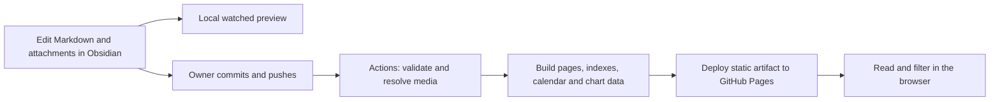

# GitHub Pages publishing design

Status: implemented locally in website/ with a prepared GitHub Pages workflow. Remote activation and deployment have not been performed. The original architecture record below is retained for context; the operating instructions in this section describe the delivered implementation.

## Run and publish

Use Node.js 24.15+, npm, the existing core dependencies, and ffmpeg for video posters. From the repository root, install the core dependencies as documented in Setup, then:

```powershell
cd website
npm ci --ignore-scripts
npm run dev
```

The terminal prints the preview URL. Keep the server running and edit the existing AntJournal vault. Added/edited/renamed/deleted notes and pages are discovered automatically. Stop it with Ctrl+C.

```powershell
npm test
npm run check
npm run build
npm run preview
```

The website reads real source YAML, sharing validation, statistics, feeding logic, and chart geometry with the core. It supports Markdown and Obsidian embeds, responsive images, video posters, theme selection, search and URL filters, a multi-colony calendar, chart/date controls, measurement tables, and feeding dates/counts in the selected period. Pages/**/*.md and new colony cards are discovered without menu/configuration edits.

The build checks internal links, repository subpaths, missing LFS objects, original-media hashes, and a 900 MiB size budget. It warns at 750 MiB. Only referenced media is included. All original media stays unchanged; derived files and website output stay ignored. Existing Home.md and Archive.md do not need to be regenerated for this website.

One time on GitHub, select Settings → Pages → GitHub Actions. The supplied .github/workflows/pages.yml checks pushes and pull requests and deploys only from the repository's default branch. The owner performs normal commits/pushes; the workflow never writes commits, creates tags, or modifies repository content. Pages origin/base paths are discovered automatically. A real hosted media smoke test remains pending until the owner activates Pages and publishes.

Local verification covered calendar entries for several colonies on one date, colony filtering, full-text observation search, calculated production and date filtering, light/dark layouts, and a 390-pixel responsive viewport with no horizontal document overflow. An isolated watched test vault passed add/edit/rename/delete and changed-measurement scenarios without restarting the server. No synthetic records were added to the real journal. The real archive retains its measurement warnings instead of having facts adjusted.

The current website build contains 28 content pages plus a 404 page and 11 original media files, about 60 MiB in total. Sizes/counts are snapshots of this revision and change automatically as the archive grows. No remote deployment is claimed.

## Original architecture record

## Recommended approach

Use Astro in static-output mode, with a journal-specific content loader and small browser components for filters, charts, search, and the photo viewer. Build and deploy a complete site artifact with GitHub Actions. Keep the website in a sibling `website/` directory; it reads `AntJournal/` directly, without copying notes into a second authored content tree.

Astro supports filesystem content collections and custom loaders, including Markdown rendering and a development watcher. These provide the mechanisms for this proposal; the journal adapter still needs implementation. See [content collections](https://docs.astro.build/en/guides/content-collections/) and [Content Loader API](https://docs.astro.build/en/reference/content-loader-reference/).

| Option | Fit for this archive | Decision |
| --- | --- | --- |
| Astro with a journal adapter | Custom reading layouts, typed observations, existing TypeScript calculations, focused interactive components | Recommended |
| Quartz | Strong ready-made Obsidian publishing, search, wikilinks, and backlinks; journal-specific dashboards still require extensions | Good alternative if a general note garden becomes the priority |
| Default Jekyll rendering | Straightforward Markdown publishing; this journal's data processing, media resolution, and charts would need additional integration | Less suitable for the current requirements |

This comparison is an engineering judgment based on the local code and the generators' documented capabilities. [Quartz documentation](https://quartz.jzhao.xyz/) describes its note-publishing features and extension system.

## What reactive means

There are three separate update paths:

1. **Local preview:** start the development server once. Saving, adding, renaming, or deleting a note/media file automatically refreshes the preview and all dependent views.
2. **Public website:** after the owner commits and pushes changes, Actions validates and rebuilds the website. A successful deployment updates the public archive without editing HTML, menus, calendars, or index files.
3. **Reader interactions:** colony/date filters, calendar navigation, chart selections, search, and gallery controls respond immediately in the browser using the published snapshot.

Saving a local Obsidian note alone cannot change GitHub Pages. This design introduces no automatic Git commits or pushes. An optional version check can show an unobtrusive update banner on an already-open page after a newer deployment; it should preserve the reader's position rather than force a reload.



## A single content pipeline

Create one journal snapshot for each build, using the existing pure modules:

- `src/markdown.ts`: YAML core-schema parsing, retaining calendar dates as strings.
- `src/model.ts`: measurements, approximation, unknown values, and display rules.
- `src/journal.ts`: identity validation, statistics, feeding summaries, and series.
- `src/chart.ts`: line geometry and breaks at explicitly unknown values.

These modules currently live under `ant-journal-plugin/`. Start by importing their pure exports through a thin adapter; a shared package can be extracted later if needed. Do not import the Obsidian runtime entry point into the website.

Calculate website metrics from canonical fields, not cached `_metric_*` projections. A record edited outside Obsidian must produce the same result even if those caches are missing or stale. Accumulate historical deaths before applying a display date filter. Preserve approximate values, unknown results, and the existing line-chart semantics. Browser code receives compact validated per-colony data; it does not need the YAML parser or the entire vault.

Neither the website build nor its watcher writes to observations, colony cards, attachments, Home.md, or Archive.md. The existing Archive.md is a repository-readable fallback, not an input containing the website's authoritative navigation or record list.

For the initial archive size, rebuilding the complete snapshot after a short debounce is simpler and safer than partial dependency updates. The watcher must cover the sibling vault explicitly and handle add/change/unlink and rename events, including removal from cached collections. Media changes must invalidate previews even when a filename stays the same. Optimize only after measuring build times.

## Discovery and routes

All routes below are relative to the configured site base, which may be a repository subpath.

| Source | Generated destination | Automatically derived |
| --- | --- | --- |
| Valid `Colonies/<id>.md` | `/colonies/<id>/` | Card, latest measurements, timeline, charts, gallery |
| Valid `Journal/<id>/YYYY-MM-DD.md` | `/journal/<id>/YYYY-MM-DD/` | Title fallback, date, colony, measurements, previous/next entry |
| All valid observations | `/archive/` and `/calendar/` | Filters, pagination, month groups, several colonies on one day |
| New `Pages/**/*.md` | `/pages/<relative-path>/` | General information pages, heading outline, navigation tree |
| `Docs/**/*.md` | `/guide/<relative-path>/` | Separate guide section, not the main observation feed |
| Aggregate data | `/` | Colony cards, latest entries, latest media, links to archive |

General pages require no new YAML fields: derive a title from the first H1 or filename, and a route from the relative path. Optional title/order/description overrides are conveniences, not prerequisites. All records default to public within these content roots; no per-note publish flag is needed.

Exclude Templates, FileClasses, Config, `.obsidian`, test vaults, local backups, and development files from content discovery. Dashboards receive dedicated web components rather than exposing raw `tracker` or `ant-journal` code blocks. Register Home.md, Archive.md, and dashboard paths in the link resolver so existing navigation points to the corresponding generated routes.

IDs and observation dates determine stable observation URLs; changing a colony's display name does not change them. Moving/renaming a general page changes its URL unless an optional explicit redirect is provided. Navigation updates automatically in either case. Reject route collisions instead of silently overwriting a page.

## Reading and visual design

Aim for a field journal: warm neutral background, dark readable text, restrained moss/amber accents, generous spacing, and photography as the main visual material. Use a serif reading face with a compact sans-serif interface, self-hosted or system fonts, responsive layouts, and an accessible dark theme.

- **Home:** a short introduction, real colony cards with name/species/observation date, and the newest dated entries. Derive covers from the first referenced image; show a neutral empty state when none exists.
- **Colony:** permanent facts, latest known values with their own dates, interactive charts, feeding history, chronological entries, and related media.
- **Observation:** date and colony identity, a compact readable measurement panel, the complete authored Markdown body, inline images/videos, and previous/next navigation within that colony.
- **Archive:** searchable/filterable chronological entries. Filters are represented in the query string so views can be bookmarked and shared.
- **Calendar:** a month grid with independently selectable records for each colony on a date. Empty days carry no zero measurements or inferred feeding events.
- **Charts:** SVG with point markers and date-aware lines matching the core's current behavior, approximate markers/tooltips, a legend, and an accessible data table. Render an initial chart/table statically, then enhance range controls in the browser.

The core text and links remain readable without JavaScript. Gallery controls and chart tooltips must support keyboard use; chart meaning must not depend on color alone. Every navigation element and JSON/media URL must respect the Pages base path. See [Astro's Pages deployment guide](https://docs.astro.build/en/guides/deploy/github/) for the documented site/base configuration.

## Markdown and Obsidian compatibility

Implement link and embed resolution in the Markdown syntax tree, with source-file context. Support ordinary relative Markdown links/images and the existing Obsidian forms `[[note|label]]`, `![[image.JPG]]`, and `![[clip.mp4]]`. Use a case-sensitive normalized path index; resolve unique basenames only when unambiguous. Missing or ambiguous targets produce file-specific diagnostics.

Rewrite note links to generated routes, image embeds to responsive figures, and video embeds to native `<video controls playsinline preload="none">` elements. Keep media at its authored position; provide an optional gallery view without removing prose between images. Generate sensible fallback alt labels without inventing image descriptions. Do not modify the Markdown to accomplish any of this.

Raw authored HTML requires a documented allowlist in the renderer. Publication scans remain a separate check: they are not an HTML sanitizer. Unsupported Obsidian constructs should produce an explicit diagnostic or readable fallback rather than disappear silently.

## Media and Git LFS

GitHub states that Pages does not support Git LFS directly. LFS pointer files are therefore not a website media source. The checkout action separately supports downloading LFS objects. See [Git LFS limitations](https://docs.github.com/en/repositories/working-with-files/managing-large-files/about-git-large-file-storage) and [checkout's LFS setting](https://github.com/actions/checkout).

The proposed artifact-based solution is to resolve LFS objects in the build environment, verify that referenced assets are actual bytes, and emit ordinary static media files into the Pages artifact. This is an architectural inference from the checkout and artifact deployment mechanisms, not a native Pages/LFS integration. Verify it with a real image/video deployment before accepting the implementation.

Only publish media referenced by public content, not the entire Attachments directory. This also keeps utility text files and unused uploads out of the website. Generate an output-only manifest from source paths to content-hashed URLs; preserve uppercase extension handling. Missing LFS objects fail the build instead of publishing pointer text or broken previews.

Generate responsive image derivatives and video posters during the build, cached by original content hash and processing configuration. Keep original bytes unchanged. Offer an original download when that original is included in the site. Use lazy image loading, dimensions to avoid layout shifts, native video controls, and no autoplay. Initially copy existing browser-compatible MP4 files without transcoding; unsupported formats need an explicit fallback or a separately generated viewing copy.

The inspected Attachments directory is about 61 MB, mostly video, so an initial artifact is feasible in size. This is a snapshot, not a long-term storage estimate. GitHub limits a published Pages site to 1 GB and documents bandwidth/deployment limits. See [Pages limits](https://docs.github.com/en/pages/getting-started-with-github-pages/github-pages-limits).

Add a build size report and a configurable safety budget below the hosting ceiling. Never silently omit older media to stay under budget. Define the media resolver around a storage-provider interface from the beginning: when growth requires external media storage, one configuration change and a migration can update generated URLs without editing every observation. External storage and its authorization are a separate decision; the initial design does not create releases, tags, or storage accounts.

## Build, checks, and deployment

Use a custom Pages Actions workflow, not a generated gh-pages branch or a bot committing build output. [GitHub's custom workflow documentation](https://docs.github.com/en/pages/getting-started-with-github-pages/using-custom-workflows-with-github-pages) supports a separate build artifact and deployment job.

Proposed sequence:

1. Check out the owner's published revision with referenced LFS content available and install locked dependencies.
2. Run the publication audit, journal validation, and relevant automated tests. Use a full-history checkout if invoking the existing reachable-history audit; do not claim a complete historical scan from a shallow clone.
3. Build one validated journal snapshot, resolve links/media, generate image derivatives, and render all pages plus the search/calendar/chart indexes.
4. Check links, route collisions, media pointers, artifact size, required pages, and representative accessible/mobile output.
5. Upload only website build output, then deploy through the Pages environment after successful checks. Validation errors block deployment; ordinary measurement warnings remain visible in the build summary.

Enable production deployment only for the chosen publication branch; discover that branch during implementation instead of assuming its name. Pull requests may run build checks without deploying. Start with a push trigger on that branch and a manual workflow trigger; avoid fragile path filters initially. Coalesce obsolete queued builds, and ensure an older revision cannot deploy over a newer one.

Repository content permissions stay read-only. Only the deployment job needs Pages/OIDC permissions; no personal token, repository-content write permission, source commit, tag creation, or automated push is needed. Pin workflow actions and package versions during implementation. Failed builds leave the previous successful website deployed.

One-time owner setup is choosing the repository, enabling Actions-based Pages, and confirming the site base/domain. Afterwards the regular author workflow is edit notes, attach files, and perform the owner's normal commit/push. No separate archive-render command is required for the website.

## Implementation stages and acceptance

1. **Adapter and compatibility:** load current files through the existing model; generate stable routes; resolve both Markdown and Obsidian embeds. Check stale/missing `_metric_*`, duplicate basenames, new colonies, invalid identities, and source-byte preservation.
2. **Reading experience:** implement home, colony, observation, and general-page layouts; test real text/photos/video locally without adding fictional records to the real journal.
3. **Reactive views:** add automatic calendar/feed/search indexes and chart/filter components. Test add/change/delete/rename events, several colonies per date, unknown/zero/approximate values, and date filtering after full-history calculation.
4. **Publication pipeline:** add artifact deployment configuration, base-path checks, actual LFS image/video smoke tests, media budgets, and clear failure reports. Activation/publication is a later owner action.

Completion means that adding a valid observation, colony card, image/video, or general page automatically creates every required route, index entry, calendar item, and relevant chart update. Editing an old measurement updates later cumulative values. Deleting content removes it from generated navigation and media discovery. No manual menu, JSON, chart dataset, thumbnail, HTML, or index-file edits are needed.

The implementation is local; the supplied workflow is activated through the owner's normal publication process. No Git write command or remote deployment was performed during this work.
